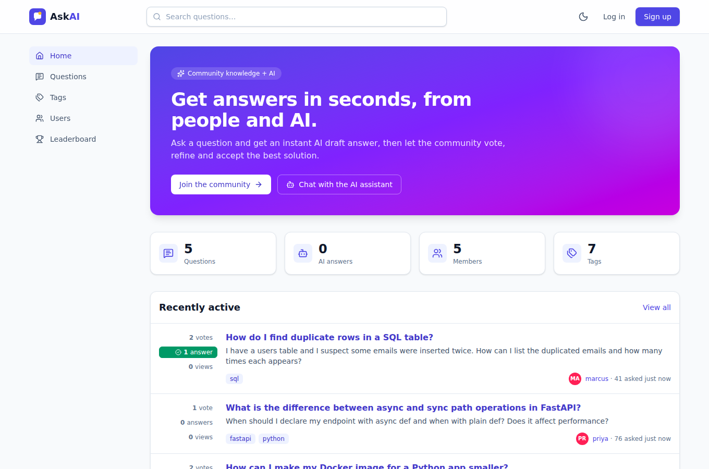
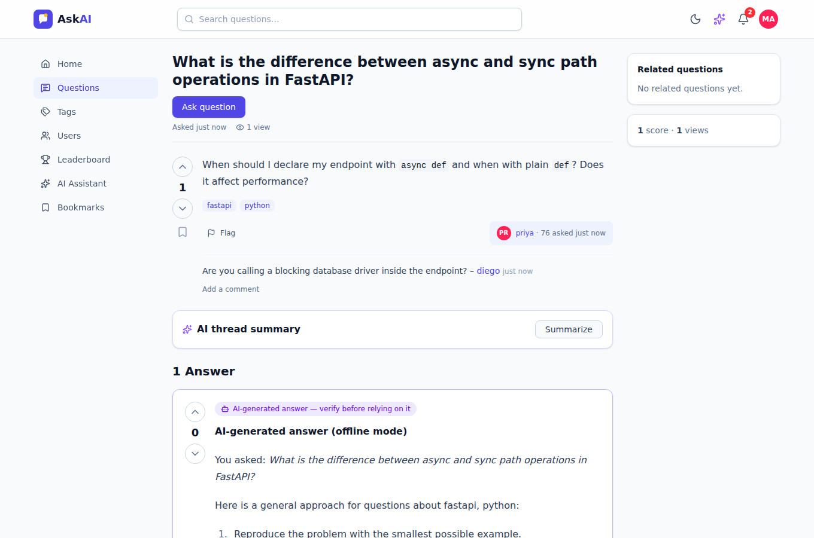
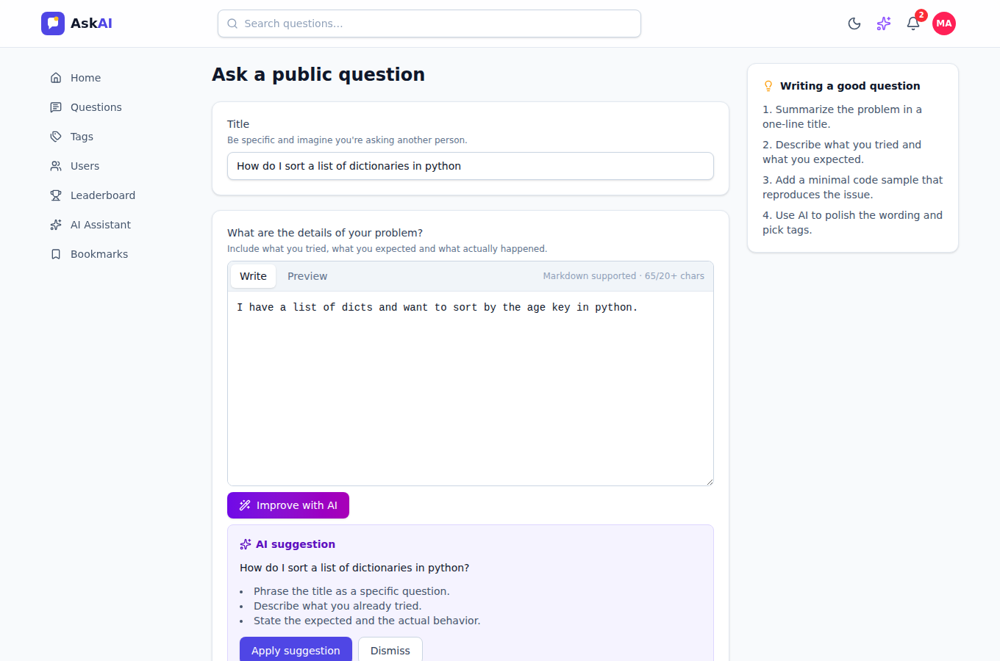
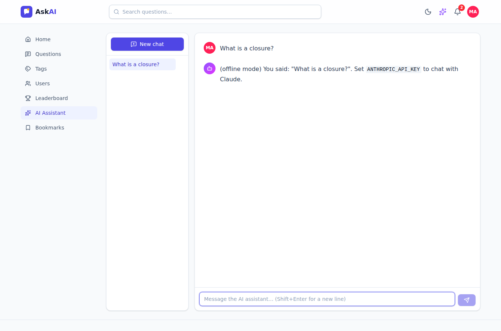
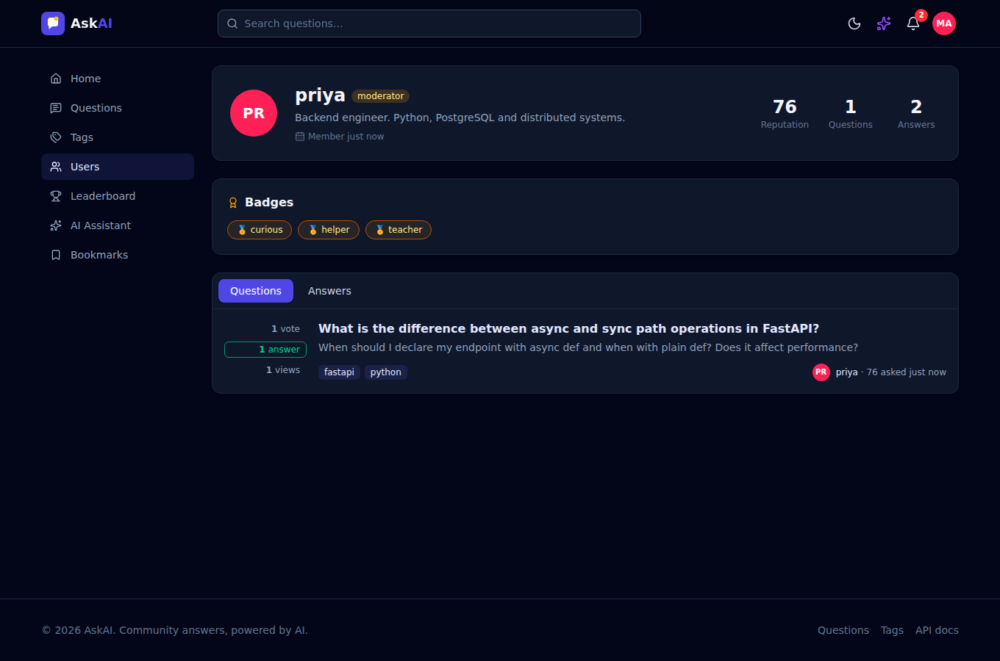

# AskAI — AI-Powered Q&A Platform

A full-stack community question-and-answer platform (in the spirit of Stack Overflow) with AI built into every step: AI-drafted answers, an AI writing coach for questions, automatic tagging, thread summaries, duplicate detection and a streaming AI chat assistant.

**Stack:** FastAPI · SQLAlchemy 2 · Oracle / PostgreSQL / SQLite · React 19 · TypeScript · Tailwind CSS 4 · Claude API · Docker · GitHub Actions



## Features

### Community Q&A
- Ask, edit and delete questions with Markdown, syntax highlighting and live preview
- Answers, comments, up/down voting and accepted answers
- Tags with descriptions, tag browsing and filtering
- Full-text search; sort by newest, active, votes, views or unanswered
- Bookmarks, user profiles, user directory and a reputation leaderboard

### AI features
| Feature | What it does |
| --- | --- |
| **AI answers** | One click posts an AI-drafted answer to any question, clearly labelled and votable/acceptable like any other answer |
| **Improve with AI** | Rewrites a draft question with a clearer title and structure, and explains what changed |
| **Suggest tags** | Reads the draft and proposes relevant tags |
| **Thread summary** | Summarizes the question, proposed solutions and the accepted answer |
| **AI assistant** | A ChatGPT-style assistant with saved conversations and token-by-token streaming (SSE) |
| **Duplicate detection** | Warns about similar existing questions while the user types a title |

The AI runs on the Claude API (`claude-opus-5-5` by default) with server-side refusal fallbacks enabled. **Without an API key, the platform switches to an offline mode** with deterministic placeholder responses, so every feature, test and demo works with no external service.

### Reputation, badges and notifications
- Reputation for upvotes (+5 question / +10 answer), accepted answers (+15) and downvotes (−2), never below 1
- Badges: *curious*, *helper*, *teacher*, *enthusiast*, *popular*, *trusted*
- In-app notifications for answers, comments, acceptances, badges and AI answers

### Moderation and administration
- Users flag spam, offensive or off-topic content
- Moderators work through a review queue: dismiss, resolve, or delete content
- Admins promote moderators and suspend accounts. The first registered account becomes admin.
- Role-based permissions on every endpoint, plus per-user rate limiting on AI endpoints

### Product quality
- Responsive layout with a mobile drawer, dark mode, toasts, loading/empty/error states
- Lazy-loaded routes; untrusted Markdown is rendered without raw HTML
- 166 backend tests (98% coverage) run on SQLite **and Oracle Database**, plus 36 frontend tests
- Multi-stage Docker image (non-root, healthcheck) and docker-compose with Oracle

| Question with an AI answer | Ask page with AI tools |
| --- | --- |
|  |  |
| **AI assistant** | **Dark mode** |
|  |  |

## Quick start

### Option 1: Docker with Oracle (recommended)

```bash
cp .env.example .env            # optionally set ANTHROPIC_API_KEY and SECRET_KEY
docker compose up --build -d
docker compose exec app python -m app.seed   # optional demo content
```

Open <http://localhost:8000>. Interactive API docs are at <http://localhost:8000/docs>.

### Option 2: Docker with SQLite (single container)

```bash
docker compose -f docker-compose.sqlite.yml up --build
```

### Option 3: Local development

Requirements: Python 3.11+, Node.js 20+.

```bash
make install       # backend + frontend dependencies
make seed          # demo users and questions (password: demo12345)
make dev-backend   # API on http://localhost:8000
make dev-frontend  # UI on http://localhost:5173 (proxies /api to the backend)
```

Demo accounts after seeding: `admin`, `priya` (moderator), `marcus`, `lena`, `diego`, all with password `demo12345`.

## Configuration

All settings are environment variables (or a `.env` file); see [`.env.example`](.env.example).

| Variable | Default | Description |
| --- | --- | --- |
| `SECRET_KEY` | dev value | **Set in production.** Signs login tokens |
| `DATABASE_URL` | `sqlite:///./qa_platform.db` | SQLAlchemy URL: SQLite, Oracle (`oracle+oracledb://…`) or PostgreSQL |
| `ANTHROPIC_API_KEY` | – | Enables real AI responses |
| `AI_PROVIDER` | `auto` | `auto`, `claude` or `mock` |
| `AI_MODEL` | `claude-opus-5-5` | Claude model ID |
| `AI_EFFORT` | `medium` | Reasoning effort: `low` … `max` |
| `ACCESS_TOKEN_EXPIRE_MINUTES` | `1440` | Login session length |
| `CORS_ORIGINS` | localhost:5173 | Allowed browser origins in development |

## Testing

```bash
make test          # backend (pytest) + frontend (vitest)
make test-oracle   # backend suite against Oracle (start it with docker compose up oracle)
make lint          # ruff, TypeScript and prettier checks
```

CI runs lint, both test suites, the backend suite on a real Oracle Database service, and a Docker build with a smoke test on every push.

## Project structure

```
backend/
  app/
    models/        SQLAlchemy models (users, questions, answers, votes, tags, chat, flags…)
    schemas/       Pydantic request/response models
    routers/       FastAPI routes, one module per resource
    services/      AI provider, reputation, badges, notifications, search
    main.py        App factory; also serves the built React app
    seed.py        Demo data
  tests/           pytest suite (SQLite or Oracle via TEST_DATABASE_URL)
frontend/
  src/
    api/           Typed API client and SSE streaming
    components/    Reusable UI components
    pages/         Route pages
    context/       Auth, theme and toast providers
    test/          Vitest + Testing Library suite
docs/              Architecture, API and deployment guides
```

## Documentation

- [Architecture](docs/ARCHITECTURE.md)
- [API reference](docs/API.md)
- [Deployment guide](docs/DEPLOYMENT.md)
- [Contributing](CONTRIBUTING.md)
- [Security policy](SECURITY.md)

## License

[MIT](LICENSE)
